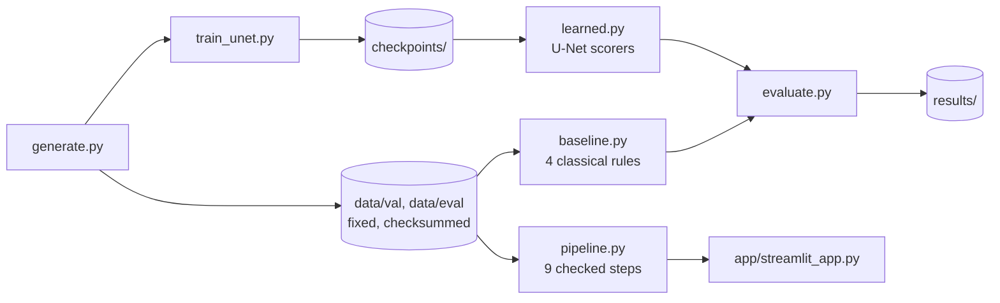

# craquelure-fusion

**Question:** does adding an independent height map stop a crack detector from being fooled?

A crack in a painting is **dark AND sunken**. Two things imitate half of that:

| | dark in the photo | sunken in height | fools |
|---|---|---|---|
| crack | yes | yes | (the target) |
| painted stroke | yes | no (slightly raised) | a colour-only detector |
| impasto valley | barely (a little shadow) | yes, with raised rims | a height-only detector |

Everything runs on synthetic samples where the answer is known for every pixel: V-shaped cracks, raised strokes, impasto valleys with rims and shadow, sensor noise on both channels, and a height map shifted up to 1.5 px against the photo, as real scans are.

Six models are compared: four classical rules built on one detector (black top-hat), and two small U-Nets.

## Results

30 evaluation samples (seeds 3000+), never used for any choice. Each model's cutoff is set on a separate validation set (seeds 2000+) at 90% recall. A predicted pixel counts if it is within 2 px of the truth.

| model | AP | precision | recall | strokes called crack | impasto called crack |
|---|---|---|---|---|---|
| colour only | 0.71 | 0.60 | 0.94 | 86% | 0% |
| height only | 0.25 | 0.37 | 0.93 | 0% | 100% |
| colour OR height | 0.61 | 0.46 | 0.96 | 85% | 94% |
| **colour AND height** | 0.94 | 0.85 | 0.98 | 0% | 37% |
| U-Net, photo only | 0.69 | 0.62 | 0.95 | 84% | 0% |
| **U-Net, photo + height** | 1.00 | 1.00 | 0.95 | 0% | 0% |

What this shows:

- **Two sensors are not enough on their own; how you combine them decides it.** OR keeps both confusers. AND beats colour only by +0.23 AP [+0.11, +0.37] and OR by +0.34 [+0.22, +0.46] (mean over 30 paired samples, 95% bootstrap interval).
- **AND leaks on impasto (37%).** The cause is the shadow in the valleys: switch it off and AND rejects impasto too (pinned in `tests/test_baseline.py`). A rule that needs "dark AND sunken" is fooled by anything that is a little of both.
- **The U-Net that sees both channels removes both confusers** and beats AND by 0.06 AP [0.01, 0.13]. Without the height map it does no better than the colour-only rule.
- **Misalignment:** shift the height map against the photo and AND drops from 0.98 to 0.69 AP (pooled) at 4 px. The photo + height U-Net holds 0.95. It was trained with shifts of at most 1.5 px.

**Limits.** All data is synthetic, and the U-Nets were trained on the same generator as the test samples (on other seeds, 10000+). A near-perfect score says the task is learnable from these two channels, not that the model works on real paintings. A real capture is the next step.

## How it fits together

| file | job |
|---|---|
| `craquelure_fusion/generate.py` | one synthetic sample (photo, height map, three masks); save and load |
| `craquelure_fusion/eval_set.py` | build and verify the fixed validation and evaluation sets (sha256 manifest; refuses to rebuild in place) |
| `craquelure_fusion/baseline.py` | four score maps from one detector: colour, height, OR (max), AND (geometric mean) |
| `craquelure_fusion/unet.py`, `train_unet.py`, `learned.py` | the U-Net, its training on freshly generated samples, and loading a checkpoint as a scorer |
| `craquelure_fusion/metrics.py` | tolerant (2 px) precision and recall, exact PR curve and AP, false-alarm rate per confuser |
| `craquelure_fusion/evaluate.py` | the protocol above; writes everything in `results/` |
| `craquelure_fusion/pipeline.py` | the same experiment as nine named steps with pass conditions, plus demo faults |
| `app/streamlit_app.py` | the interactive page |

## Run

    conda create -n crack python=3.12 -y && conda activate crack
    pip install -r requirements.txt
    python -m pytest -q                                      # 53 tests, about a minute
    python -m craquelure_fusion.eval_set --split eval --verify
    python -m craquelure_fusion.evaluate                     # writes results/
    streamlit run app/streamlit_app.py

The trained checkpoints are in `checkpoints/`. To retrain:

    python -m craquelure_fusion.train_unet --channels photo+height --out checkpoints/unet_4ch.pt
    python -m craquelure_fusion.train_unet --channels photo --out checkpoints/unet_3ch.pt

**macOS:** scipy older than 1.17.1 fails to load on recent macOS, and scipy 1.17 needs Python 3.11 or newer, hence Python 3.12.

## The page

Press *Run pipeline* and watch nine steps run in four phases (make the data, check it, score every pixel, measure). Each step turns green or red; *What's inside* explains it and *What it did* shows its log. On clean data the measure step goes red on purpose: that is the 37% impasto leak, and the results below it are still shown in full. The sidebar injects faults (a tampered file, the height sensor off, a model bug, a 6 px misalignment), each caught by a different step. Faults run in memory or on a temporary copy; the committed data is never touched.

The data sets are never rebuilt in place: `eval_set` refuses, so every number in this README can be reproduced from the committed files.
