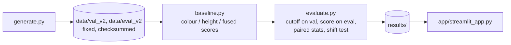

# craquelure-fusion

**Question:** does adding an independent height map stop a crack detector from being fooled?

A crack in a painting is **dark AND sunken**. Two things imitate half of that:

| | dark in the photo | sunken in height | fools |
|---|---|---|---|
| crack | yes | yes | (the target) |
| painted stroke | yes | no | a colour-only detector |
| impasto valley | no | yes | a height-only detector |

Only the conjunction separates a crack from both. This repo tests that on synthetic data where the answer is known for every pixel.

## Result (eval set v2, 30 samples, cutoffs chosen on a separate validation set at 90% recall)

| model | AP | strokes called crack | impasto called crack |
|---|---|---|---|
| colour only | 0.51 | 96% | 0.7% |
| height only | 0.49 | 0.3% | 91% |
| colour + height | 1.00 | 0.4% | 0.6% |

Fused minus each single sensor, paired over the same 30 samples: AP +0.49 (95% CI +0.43 to +0.55) vs colour, +0.51 (+0.46 to +0.56) vs height; Wilcoxon p < 1e-8.
Stress test: shifting the height map against the photo drops fused AP from 1.00 (0 px) to 0.89 (4 px). Alignment limits fusion.

**Limits, said plainly:** synthetic data with clean, deliberately symmetric confusers; a classical (non-learned) detector; no real sensor noise. AP near 1.0 means the data is easy, not that the problem is solved.

## Pipeline

| file | job |
|---|---|
| `craquelure_fusion/generate.py` | one synthetic sample: canvas, crack, stroke, impasto; save and load |
| `craquelure_fusion/eval_set.py` | build and verify the fixed data sets (sha256 manifest; refuses to rebuild in place) |
| `craquelure_fusion/baseline.py` | three score maps from one detector (black top-hat); fused = geometric mean (AND) |
| `craquelure_fusion/metrics.py` | tolerant (2 px) precision/recall, PR curve, AP, false-alarm rate per confuser |
| `craquelure_fusion/evaluate.py` | the experiment protocol and all outputs in `results/` |
| `app/streamlit_app.py` | presentation: question, one sample, results |
| `data/eval_v1` | first data set (no impasto), kept for history; shows why v2 was needed |

## Run

    pip install -r requirements.txt
    python -m pytest -q                                   # 30 tests
    python -m craquelure_fusion.eval_set --split eval --verify
    python -m craquelure_fusion.evaluate                  # ~10 s, writes results/
    streamlit run app/streamlit_app.py

Fixed sets are never rebuilt in place. A change to the data design gets a new version (`--version`).
`practice/` holds learning exercises and is not part of the test run.
