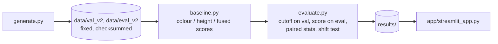

# craquelure-fusion

**Question:** does adding an independent height map stop a crack detector from being fooled?

A crack in a painting is **dark AND sunken**. Two things imitate half of that:

| | dark in the photo | sunken in height | fools |
|---|---|---|---|
| crack | yes | yes | (the target) |
| painted stroke | yes | no | a colour-only detector |
| impasto valley | no | yes | a height-only detector |

This repo tests, on synthetic data where the answer is known for every pixel, whether the two sensors must AGREE for the confusers to drop out.

## Result (eval set v2: 30 unseen samples, seeds 3000+; cutoffs chosen on a separate validation set at 90% recall)

| model | AP (mean per sample) | cracks found | strokes called crack | impasto called crack |
|---|---|---|---|---|
| colour only | 0.56 | 96% | 96% | 0% |
| height only | 0.55 | 90% | 0% | 91% |
| colour OR height (either sensor) | 0.53 | 90% | 50% | 88% |
| colour AND height (both agree) | 1.00 | 96% | 0% | 0% |

- Having two sensors is not enough: OR-fusion is fooled by both confusers. Fusion that requires agreement removes both. (A plain average of the two scores does as well as the geometric mean here; the point is agreement, not one formula.)
- AND minus each other model, AP: +0.44 [0.37, 0.50] vs colour, +0.45 [0.40, 0.51] vs height, +0.47 [0.41, 0.53] vs OR (mean over 30 paired samples, 95% bootstrap interval).
- Alignment stress test: AND-fusion keeps AP 1.00 up to a 2 px shift of the height map, then 0.96 at 3 px and about 0.9 at 4 px (both directions).

**Limits, said plainly.** Each confuser copies a crack exactly in one sensor, so any agreement rule is bound to win: the result shows the mechanism, not real-world accuracy. Classical detector, no real sensor noise. Next: confusers that only partly imitate a crack, sensor noise, a learned model, a real capture.

## Pipeline

| file | job |
|---|---|
| `craquelure_fusion/generate.py` | one synthetic sample: canvas, crack, stroke, impasto; save and load |
| `craquelure_fusion/eval_set.py` | build and verify the fixed data sets (sha256 manifest; refuses to rebuild in place) |
| `craquelure_fusion/baseline.py` | four score maps from one detector (black top-hat): colour, height, OR (max), AND (geometric mean) |
| `craquelure_fusion/metrics.py` | tolerant (2 px) precision/recall, PR curve, AP, false-alarm rate per confuser |
| `craquelure_fusion/evaluate.py` | the experiment protocol and all outputs in `results/` |
| `craquelure_fusion/pipeline.py` | the experiment as six named steps with pass conditions, plus demo faults (in memory only) |
| `app/streamlit_app.py` | interactive page: run the six steps, watch each turn green or red, click a step for what it does, results underneath |
| `data/eval_v1` | first data set (no impasto, seeds 1000+), kept for history; shows why v2 was needed |

## Run

    conda create -n crack python=3.12 -y && conda activate crack
    pip install -r requirements.txt                       # on macOS this pulls scipy >= 1.17.1
    python -m pytest -q                                   # 43 tests
    python -m craquelure_fusion.eval_set --split eval --verify
    python -m craquelure_fusion.evaluate                  # ~30 s, writes results/
    streamlit run app/streamlit_app.py                    # opens http://localhost:8501

**macOS note:** scipy older than 1.17.1 fails to load on recent macOS (`_spropack ... __thread_bss`); scipy 1.17+ needs Python 3.11+, hence the Python 3.12 environment.

**The page:** press *Run pipeline*. A progress bar fills as six steps run; each box turns green (passed) or red (failed); later steps are skipped after a failure. *What's inside* on any box explains the step, its pass condition, and, on failure, the file and line where it broke. The sidebar can inject a fault (tampered file, height sensor off, model bug, 6 px misalignment), each caught by a different step. Faults run in memory or on a temporary copy; committed data is never touched.

Fixed sets are never rebuilt in place. A change to the data design gets a new version (`--version`).
`practice/` holds learning exercises and is not part of the test run.
